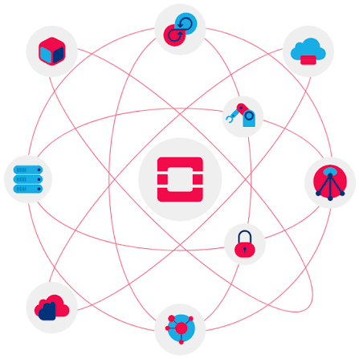

# OpenStack

OpenStack is a set of software components that provide common services for cloud infrastructure.

## Índice

1. [Introducción](introduccion.md)
2. [Componentes principales](componentes.md)
3. [Entorno de pruebas](entorno-pruebas.md)

## Referencias

- [OpenStack](https://www.openstack.org/)
- [Documentación oficial de OpenStack](https://docs.openstack.org/)

## Autores
- Manuel Rondán Gallardo
- Sergio Quemada López
